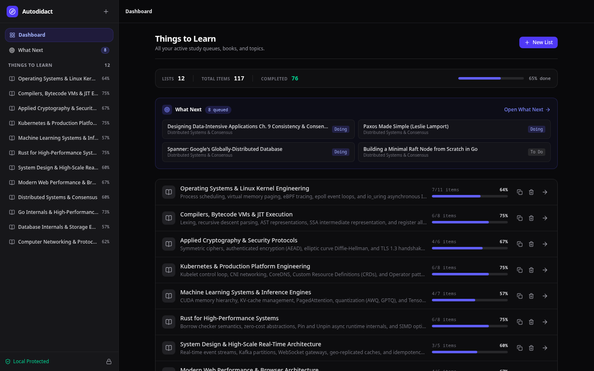
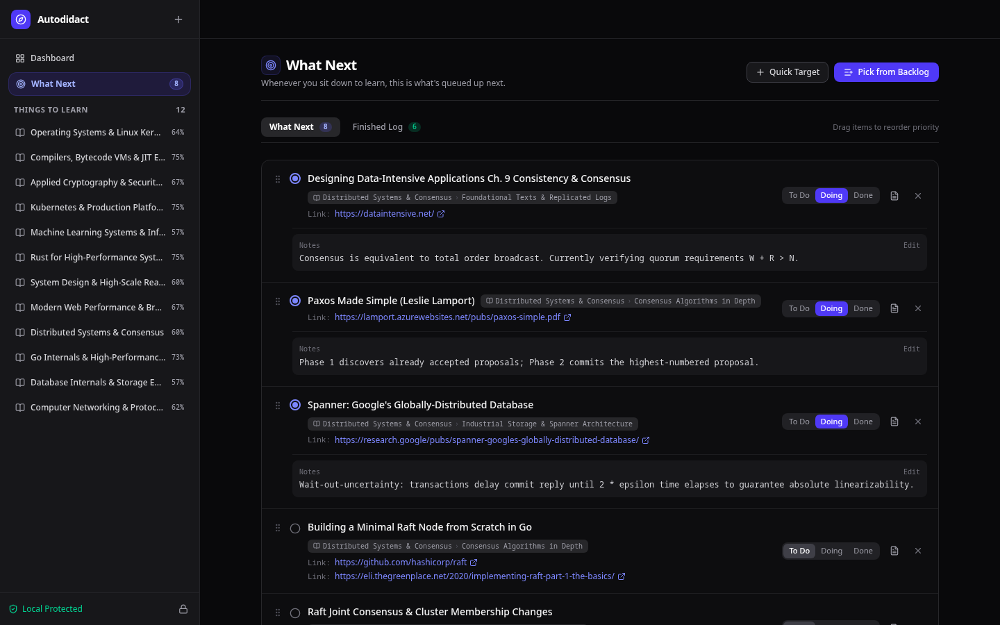
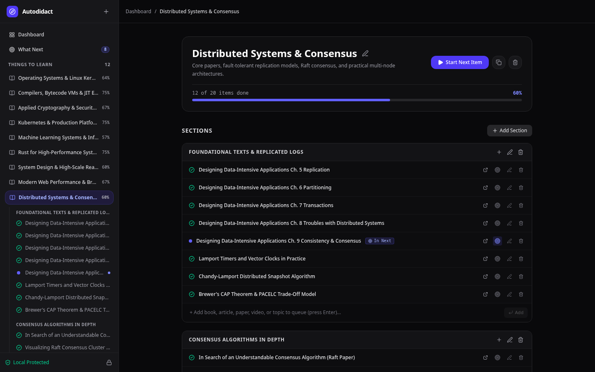
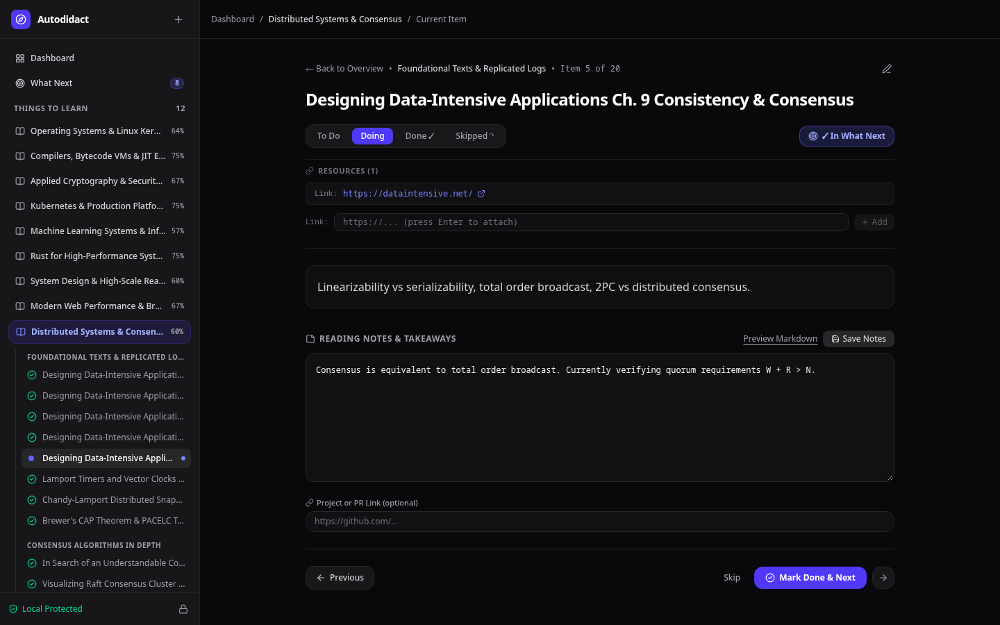

# Autodidact

Autodidact is an informal, distraction-free **"Things to Learn"** queue engine built for self-taught learners. It organizes chaotic learning materials (books, papers, documentation, talks, and experiment ideas) into ordered sections so you can conquer them one at a time.

## Preview

| **Dashboard** | **What Next Queue** |
| :---: | :---: |
|  |  |
| **Syllabus View** | **Item Workspace** |
|  |  |

## Features

- **Compact Dashboard:** High-density overview of all syllabi, progress metrics, and active focus targets.
- **What Next Queue:** Drag-and-drop priority queue with quick-pick drawer, atomic ordering, and completed log.
- **Multi-Resource Links:** Attach unlimited documentation, papers, and book URLs to any item.
- **Focused Workspace:** Distraction-free view with status toggles, markdown notes preview, and sequential navigation.
- **Continuous Quick-Add:** Keyboard-first input flow that retains focus for rapid syllabus drafting.
- **Local Security:** Bound to `127.0.0.1` by default with optional token-based authentication.

## Tech Stack

- **Frontend:** SvelteKit (Svelte 5 runes mode), Tailwind CSS, Lucide icons, Marked (Markdown).
- **Backend:** Go 1.23+ with Chi router.
- **Database:** SQLite3 via pure Go `modernc.org/sqlite` (CGO-free, WAL mode enabled).
- **Orchestration:** Docker Compose multi-stage builds.

## Quick Start

### Running with Docker Compose

```bash
docker compose up --build
```

- **Frontend:** [http://localhost:3000](http://localhost:3000)
- **Default Security Key:** `autodidact-local-key`

### Running Locally Without Docker

```bash
# Terminal 1 - Backend
cd backend
go run ./cmd/api

# Terminal 2 - Frontend
cd frontend
npm run dev
```

Visit [http://localhost:5173](http://localhost:5173).

## License

[MIT](LICENSE)
